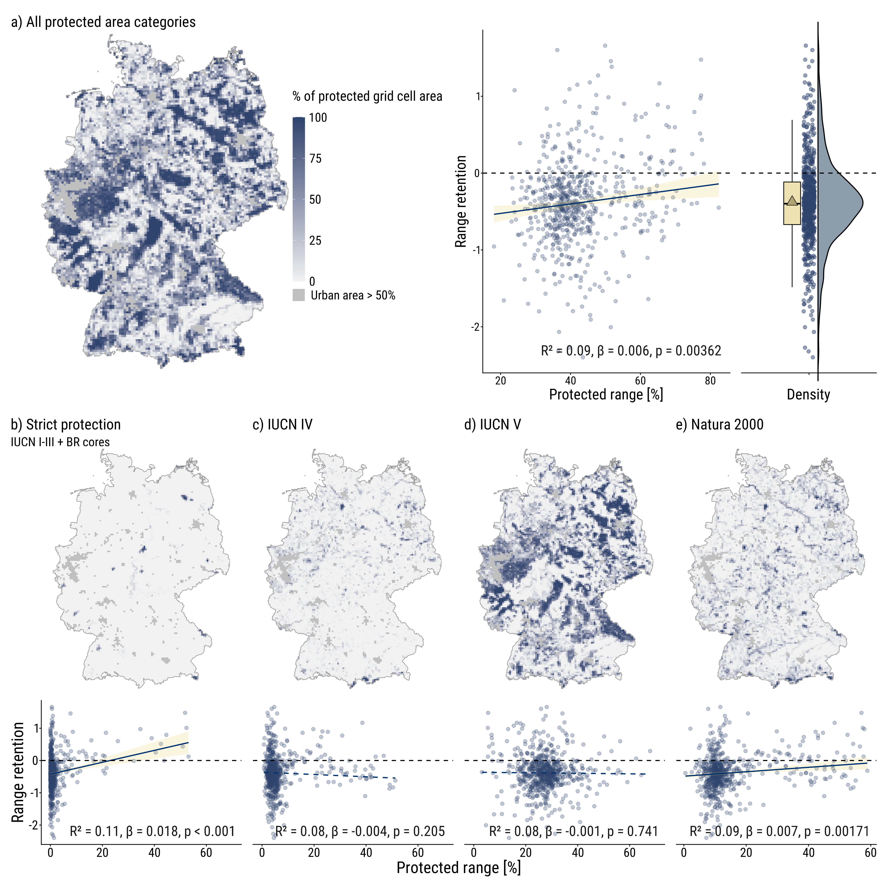
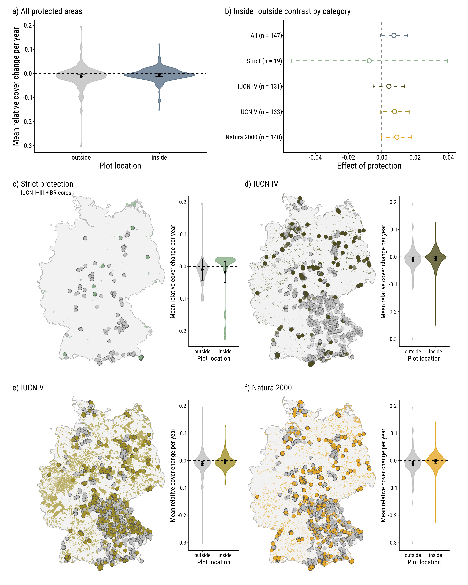
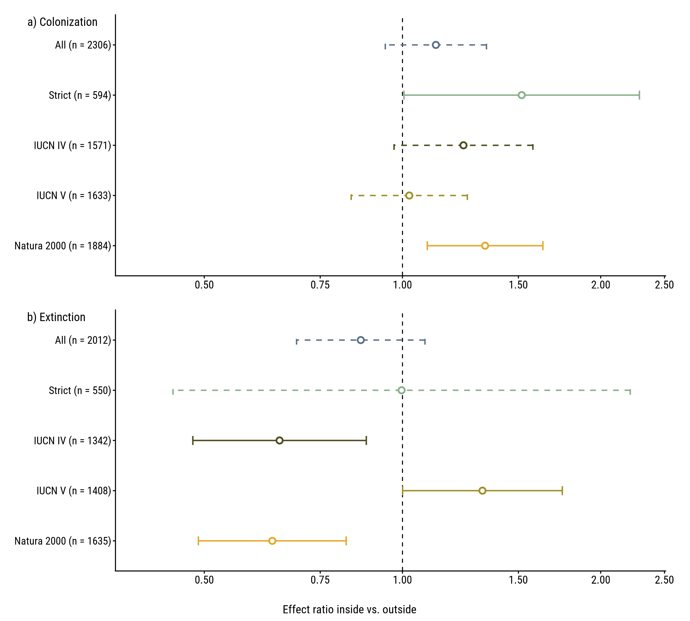

# Mixed evidence that protected areas slow declines of threatened plant species in Germany

This repository contains the R code and reproducibility workflow accompanying the manuscript:

**Mixed evidence that protected areas slow declines of threatened plant species in Germany**

The study investigates whether German protected areas are associated with improved persistence of nationally red-listed plant species. We analysed two complementary datasets at different spatial scales:

1. **Range-scale analysis** based on modelled occurrence probabilities of vascular plants in grid cells of the German mapping grid (MTB quadrants; Eichenberg et al. 2021)
2. **Plot-scale analysis** based on repeated vegetation-plot resurveys from the ReSurvey Germany dataset (Jandt et al. 2022)

These analyses compare protected and unprotected areas between the following protected-area categories:

- all protected areas;
- strict protected areas (IUCN categories I–III and biosphere reserve core zones; polygon-based National Natural Monuments are also included in this group);
- IUCN category IV;
- IUCN category V; and
- Natura 2000 sites designated under the Habitats Directive.

This repository only contains analysis code, figure-creation code, some selected derived data that can be shared, the final figures and the R-package lists. Third-party datasets and most spatial data are **not** included and have to be downloaded separately. The directions for obtaining the data are provided in this README file, as well as the supplementary material of the manuscript.

## Repository structure

``` text

threatened-plants-protected-area-publication/
│
├── R-scripts/
│   ├── 01-prepare-protected-areas.R
│   ├── 02-figure-S1-pa-size.R
│   │
│   ├── taxonomy/
│   │   └── 01-taxonomic-harmonisation.R
│   │
│   ├── range/
│   │   ├── 01-build_grid_and_pa_coverage.R
│   │   ├── 02-exclude-urban-gridcells.R
│   │   ├── 03-build-range-dataset.R
│   │   ├── 04-fit-range-models.R
│   │   ├── 05a-range-figure-helpers.R
│   │   ├── 05b-figure1-range-main.R
│   │   ├── 05c-range-size-protection-figure.R
│   │   ├── 05d-figureS3-withV.R
│   │   ├── 05e-figureS4-T2-T3.R
│   │   └── 06-run-range-figures.R
│   │
│   └── resurvey/
│       ├── 00-preamble-resurvey.R
│       ├── 00-run-resurvey-pipeline.R
│       ├── 00a-build-resurvey-change-table.R
│       ├── 01-build-resurvey-data.R
│       ├── 02-fit-event-models.R
│       ├── 03-analyse-cover-change.R
│       ├── 03b-robust-cover-change.R
│       ├── 03c-figure-S5-cover-without-V.R
│       ├── 04-analyse-pa-size.R
│       ├── 05-figure-2.R
│       └── 99-check-resurvey-results.R
│
├── data/
│   ├── raw/             # external raw data; not tracked by Git
│   ├── spatial/         # external spatial data; not tracked by Git
│   ├── derived/         # generated intermediate data; not tracked by Git
│   ├── taxonomy/        # manually checked WCVP matching tables
│   │   ├── red_list_wcvp_matching.csv
│   │   ├── smon_wcvp_matching.csv
│   │   └── resurvey_wcvp_matching.csv
│   └── resurvey/
│       ├── resurvey_plot_classification.csv
│       └── resurvey_plot_pa_membership.csv
│
├── diagnostics/         # model diagnostics; created by the scripts
├── figures/             # publication figures
├── results/             # model results and tables; created by the scripts
├── renv/
├── renv.lock
├── LICENSE
└── README.md
```

Intermediate files in data/derived/ are generated within the analysis and are on purpose not stored in the repository.

## Data availability

Most input data are available from the original providers and therefore not duplicated here. Users that want to reproduce this analysis should obtain the datasets listed below and place them in the indicated directories.

## 1. sMon occurence-probability data

The range-scale analyses use occurrence-probability data modelled by a Frescalo algorithm and produced in association with the sMon project. The data is associated with: Eichenberg. D. et al. (2021). *Widespread decline in Central European plant diversity across six decades.* Global change biology 27:1097-1110. DOI: [10.1111/gcb.15447](https://doi.org/10.1111/gcb.15447). The OP estimates for each species: grid cell: time step combination resulting from the Frescalo algorithm are available for download from the iDiv data portal (Eichenberg et al., 2020; <https://doi.org/10.25829/idiv.1875-8-3136>). The analysis uses all three time periods.

The data should be stored under:

``` text
data/raw/sMon/
├── 1875_9_1875_2_Modelled_OPs_incl_sd_pt_1.csv
├── 1875_9_1875_2_Modelled_OPs_incl_sd_pt_2.csv
├── 1875_9_1875_2_Modelled_OPs_incl_sd_pt_3.csv
└── 1875_9_1875_2_Modelled_OPs_incl_sd_pt_4.csv
```

## 2. ReSurvey Germany vegetation-plot resurveys

The plot-scale analyses use the ReSurvey Germany data:

Jandt. U. et al. (2022). *ReSurvey Germany: Vegetation-plot resurveys of the German flora.* Scientific Data 9: 631. DOI: [10.1038/s41597-022-01688-6](https://doi.org/10.1038/s41597-022-01688-6). Dataset DOI: [10.25829/idiv.3514-0qsq70](https://doi.org/10.25829/idiv.3514-0qsq70)

The public ReSurveyGermany files should be placed under

``` text
data/raw/resurvey/
```

and includes

``` text
ReSurveyGermany.csv
Header_ReSurveyGermany.csv
ReSurveyGermany_Description.csv
Header_ReSurveyGermany_Description.csv
ReSurveyGermany_Project_List.csv
ReSurveyGermany_References.csv
```
If *data/derived/resurvey/RS_raw.csv* has not yet been created, first run

```text
source("./R-scripts/resurvey/00a-build-resurvey-change-table.R")
```
and then run the ReSurvey pipeline.

## 3. German Red List of vascular plants

National threat status is based on:

Metzing, D. et al. (2018). *Rote Liste und Gesamtartenliste der Farn- und Blütenpflanzen (Trachaeophyta) Deutschlands.* Naturschutz und Biologische Vielfalt 70(7): 13–358. The corresponding Red List data package can be downloaded from the **Rote-Liste-Zentrum** <https://www.rote-liste-zentrum.de/die-roten-listen/download-pflanzen/> and is called **Farn- und Blütenpflanzen** from 2018.

Place the file under

``` text
data/raw/red-list/
```

This workflow uses the German Red List categories:

``` text
0, 1, 2, 3, G, R, V 
```

Individual analyses may exclude category V as a sensitivity or main-analysis; these choices are documented in the corresponding R scripts.

## 4. Protected areas

Protected-area polygons were downloaded from **Protected Planet / World Database on Protected Areas (WDPA)**. We used the version downloaded in January 2025 (WDPA_WDOECM_Jan2025_Public_DEU). The database is updated monthly, so current versions may differ slightly from the version used here. The WDPA terms of use do not allow redistribution, so the shapefiles are not included in this repository; the protected-area classification derived from them is provided for the plots in `data/resurvey/`.

The files are to be stored as:

``` text
data/spatial/Protected_areas/
└── WDPA_WDOECM_Jan2025_Public_DEU_shp/
    ├── WDPA_WDOECM_Jan2025_Public_DEU_shp_0/
    ├── WDPA_WDOECM_Jan2025_Public_DEU_shp_1/
    └── WDPA_WDOECM_Jan2025_Public_DEU_shp_2/
```

The pipelines use the polygon layers from these three WDPA partitions. Marine-only protected areas are excluded. Protected-area categories are subsequently harmonised by the analysis scripts.

## 5. HILDA+ land-use data

Urban land cover in 1960 is derived from:

Winkler, K., Fuchs, R., Rounsevell, M.D.A. & Herold, M. (2020). *HILDA+ Global Land Use Change between 1960 and 2019.* PANGAEA. DOI: 10.1594/PANGAEA.921846.

The analysis specifically uses HILDA+ vGLOB-1.0, not HILDA+ version 2.0. The dataset was only used to exclude urban areas within the **range-scale analysis**, where we only used the raster-file (.tif) for the year 1960, as this matches the baseline year of the analysis. Grid cells with more than 50% urban cover in 1960 are excluded from the range models.

The required file is:

``` text
data/spatial/hildap_vGLOB-1.0_geotiff/
└── hildap_GLOB-v1.0_lulc-states/
    └── hilda_plus_1960_states_GLOB-v1-0_wgs84-nn.tif
```

## 6. German boundary data

The German national boundary used in the range analysis is based on the VG2500 administrative-boundary dataset from the German Federal Agency for Cartography and Geodesy (BKG): <https://gdz.bkg.bund.de/index.php/default/verwaltungsgebiete-1-2-500-000-stand-01-01-vg2500.html>. The data are provided in this repository under the Data licence Germany – attribution – version 2.0:

© GeoBasis-DE / BKG (2025), [dl-de/by-2-0](https://www.govdata.de/dl-de/by-2-0). The files are unchanged (status 31.12.2024); the analysis scripts select the most recent national boundary polygon.

The files are stored under:

``` text
data/spatial/DE-boundaries/
├── VG2500_STA.shp
├── VG2500_STA.dbf
├── VG2500_STA.shx
├── VG2500_STA.prj
└── VG2500_STA.cpg
```

## 7. MTBQ grid

The range analysis uses the grid of quadrants of the topographic map 1:25,000 (Messtischblatt-Quadranten, MTBQ; c. 32 km² per cell), the grid on which the occurrence probabilities of Eichenberg et al. (2021) are provided. The grid was obtained from the Recorder-D portal of the Zentrum für Biodokumentation (<http://www.recorder-d.de/index.php/downloads/viewdownload/8-rastergrenzen/15-mtb-raster-deutschland-wgs84-shapeformat>). This download link is no longer available, so the grid used for the analyses is provided in this repository, reprojected to ETRS89 / UTM zone 32N (EPSG:25832).

The quadrants follow the official TK25 sheet division of the BKG (Blattschnitt der Topographischen Karte 1:25 000, <https://gdz.bkg.bund.de/index.php/default/blattschnitt-der-topographischen-karte-1-25-000-tk25-b25.html>; © GeoBasis-DE / BKG (2025), [dl-de/by-2-0](https://www.govdata.de/dl-de/by-2-0)). The official sheet outlines contain whole sheets only and are positioned c. 150 m differently from the grid used here, so they cannot replace it without changing the results slightly.

``` text
data/spatial/MTBQ/
├── MTBQ_25832.shp
├── MTBQ_25832.dbf
├── MTBQ_25832.shx
└── MTBQ_25832.prj
```

### Confidential ReSurveyGermany coordinates

Exact coordinates of some ReSurvey Germany plots are confidential and are therefore not distributed with this repository.

Protected-area membership was determined locally using the exact coordinates used for the manuscript analysis. For reproducibility, the repository provides:


``` text
data/resurvey/resurvey_plot_classification.csv
data/resurvey/resurvey_plot_pa_membership.csv
```
The file resurvey_plot_classification.csv contains the protected-area classification used in the analyses together with the publicly available approximate plot coordinates used for visualization. No confidential coordinates are included.

The file resurvey_plot_pa_membership.csv contains the non-spatial protected-area memberships and protected-area sizes of the plots required for the supplementary protected-area-size analyses. It also contains no plot coordinates.

## Software environment

All analyses were performed in **R**. Package versions are recorded using renv. After cloning the repository, restore the environment with

``` text
install.packages("renv")
renv::restore()
```

Figures within this publication use **Roboto Condensed**. The figure scripts use the sysfonts and showtext packages to register the font.

## Analysis execution

All scripts assume that the working directory is the root of this repository.

## Protected areas and taxonomy

Two preparation scripts have to be run first. The protected-area layer is used by the ReSurvey pipeline (the range pipeline classifies the WDPA polygons in the same way in `range/01-build_grid_and_pa_coverage.R`):

``` text
source("./R-scripts/01-prepare-protected-areas.R")
source("./R-scripts/02-figure-S1-pa-size.R")   # Figure S1
```

Taxon names of all three datasets were matched to the World Checklist of Vascular Plants (WCVP) with the rWCVP package and checked manually. The checked matching tables are stored in `data/taxonomy/` and are read by:

``` text
source("./R-scripts/taxonomy/01-taxonomic-harmonisation.R")
```

as the following scripts expect, among others

``` text
data/derived/taxonomy/smon_wcvp_lookup.csv
data/derived/taxonomy/smon_species_master.csv
```

The ReSurvey workflow uses the corresponding harmonised ReSurvey and national Red List lookup tables.

## Range-scale analysis

The range-scale analysis uses modelled occurrence probabilities for each species and grid cell. For each species, baseline cells are defined as grid cells with a positive occurrence probability at the start of the analysis interval. National range size is represented by the sum of occurrence probabilities:

``` text
SOP = sum of occurrence probabilities across grid cells
```

Range retention is calculated as:

``` text
log(SOP_end / SOP_start)
```

Protected range share is calculated as the baseline-occurrence-probability-weighted proportion of each species' range covered by protected areas. The model fitted is:

``` text
range retention ~ protected range share + log(baseline SOP)
```

We fitted separate models for each protected-area category (i.e. strict, IUCN IV, IUCN V, Natura 2000).

### Run the range pipeline in this order:

``` text
source("./R-scripts/range/01-build_grid_and_pa_coverage.R")
source("./R-scripts/range/02-exclude-urban-gridcells.R")
source("./R-scripts/range/03-build-range-dataset.R")
source("./R-scripts/range/04-fit-range-models.R")
source("./R-scripts/range/06-run-range-figures.R")
```

Three analyses are carried out through the model script:

- T1 -\> T3, 860 species, main analysis including Red List category V;
- T2 -\> T3, 855 species, temporal sensitivity analysis;
- T1 -\> T3, 658 species, sensitivity analysis excluding Red List category V.

## ReSurveyGermany analysis

The ReSurveyGermany pipeline evaluates local changes in threatened plant species using repeated vegetation plots. The workflow includes: - preparation of plot-by-species survey intervals; - protected-area classification; - species-level cover-change analyses; - plot-level colonisation and extinction models; - protected-area-size analyses (SI); - figure creation

### Run the pipeline using:

``` text
source("./R-scripts/resurvey/00-run-resurvey-pipeline.R")
```

Settings, helper functions and paths are defined in

``` text
R-scripts/resurvey/00-preamble-resurvey.R
```

## Outputs

### Figures are saved in

``` text
figures/range/
figures/resurvey/

```






### Results are written to

``` text
results/
```

### Model diagnostics are written to

``` text
diagnostics/
```

## Primary data references

**Eichenberg et al. (2021)**

Eichenberg, D., Bowler, D.E., Bonn, A., Bruelheide, H., Grescho, V., Harter, D., Jandt, U., May, R., Winter, M. & Jansen, F. Widespread decline in Central European plant diversity across six decades. Global Change Biology 27, 1097–1110. DOI: 10.1111/gcb.15447.

**Jandt et al. (2022)** 

Jandt, U., Bruelheide, H., Berg, C. et al. *ReSurveyGermany: Vegetation-plot time-series over the past hundred years in Germany.* Scientific Data 9, 631. DOI: 10.1038/s41597-022-01688-6. Dataset DOI: 10.25829/idiv.3514-0qsq70.

**Metzing et al. (2018)** 

Metzing, D. et al. *Rote Liste und Gesamtartenliste der Farn- und Blütenpflanzen (Trachaeophyta) Deutschlands.* Naturschutz und Biologische Vielfalt 70(7), 13–358.

**Winkler et al. (2020)**

Winkler, K., Fuchs, R., Rounsevell, M.D.A. & Herold, M. *HILDA+ Global Land Use Change between 1960 and 2019.* PANGAEA. DOI: 10.1594/PANGAEA.921846.


Protected-area data were obtained from **UNEP-WCMC / IUCN Protected Planet** and are subject to the original data-provider terms.

### Citation

Please cite the underlying datasets according to their respective data-use requirements. If you use this repository, please cite the associated manuscript.

## AI assistance

This repository was developed with assistance from Claude (Anthropic) for code structuring, writing, and shortening. All analytical decisions, interpretation, and final responsibility for the code and results remain with the author.

## License

The R code in this repository is released under the MIT License (see `LICENSE`).

The data files keep the terms of their original sources: the German boundary (VG2500) and the TK25 sheet division are © GeoBasis-DE / BKG, dl-de/by-2-0; the taxonomic matching tables in `data/taxonomy/` contain names and Red List categories from Metzing et al. (2018), the sMon occurrence data (Eichenberg et al. 2021) and ReSurvey Germany (Jandt et al. 2022), matched to the World Checklist of Vascular Plants (Govaerts et al. 2021). Please cite these sources when reusing the files.
